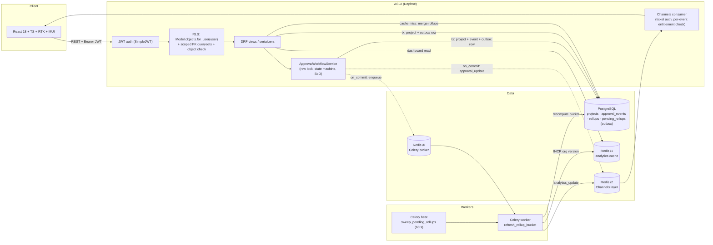

# Design: Multi-Tenant CapEx Budget & Approval Platform

This document describes what the code **does**. Where it describes production work that is not built, it says so. Every number in §9 was measured; the conditions are stated there.

---

## 1. Architecture and the path of a request

### A write (create, edit, delete, or approve)
1. **Authenticate.** `JWTAuthentication` loads the user from the database on every request, so entitlements are never trusted from token claims.
2. **Scope.** The view's queryset is `Model.objects.for_user(user)`. Writes re-read the row under `SELECT … FOR UPDATE` (§5).
3. **Validate.** For approvals, the state machine checks role, current state, and segregation of duties. For edits, `status` is rejected and scope fields are frozen once the project leaves `draft`.
4. **Record, atomically.** The same database transaction writes the project or audit event **and** an outbox row in `PendingRollup(property, fiscal_period)`.
5. **After commit.** The app enqueues `refresh_rollup_bucket` and broadcasts `approval_update` to `org_{id}`. If Redis is unavailable, both are skipped quickly (§3.5). The outbox row still guarantees the refresh will happen.
6. **Worker.**
   - Recomputes that one bucket.
   - Increments the org's cache version.
   - Deletes the outbox row, but only if nothing re-requested it during the computation.
   - Broadcasts `analytics_update`. Dashboards refetch on that event.

### A dashboard read
1. Authenticate.
2. Resolve entitled properties (database).
3. Read the org version from Redis.
4. Build the cache key: `analytics:org:{org}:v{version}:props:{sha256(props)}:fp:{period}`.
5. On a hit, return it. On a miss, merge the precomputed rollup rows (3 per property for `ALL`) and cache the result.

---

## 2. Authorization model and enforcement

| Role | Scope | Can do |
|---|---|---|
| `org_admin` | Every property in the org; never another org | Everything, including the "break-glass" exemption from segregation of duties (still audited) |
| `property_manager` | Its `property_ids` | Create and edit projects, submit, sign the manager level, reject |
| `approver` | Its `property_ids` | Sign the manager, finance, and final levels; reject |
| `viewer` | Its `property_ids` | Read only |

### Where RLS lives
- `TenantScopedQuerySet.for_user(user)` filters by `org_id`, and for non-admins also by `property_id IN (assigned)`. Every request-path read and write starts from it, including the workflow service's locked fetch.
- **Foreign keys are scoped too.** `ProjectSerializer.property` uses `Property.objects.for_user(user)`, so another tenant's property ID produces the same "Invalid pk" error as a nonexistent one. That removes an ID-existence oracle.
- `TenantObjectPermission` is a second, defence-in-depth check on object views.
- `status`, `org`, `submitted_by`, and `created_at` are server-controlled. Writing `status` is rejected with 400 and a pointer to `/approve/`.
- **Centrally enforced, not just centrally defined.** `tests/test_authz_routes.py` walks every registered object route (`<pk>`, `<project_id>`) for every HTTP method. For out-of-scope IDs it asserts the response is 404, or 403/405 when the route rejects before any lookup, never data. An endpoint that forgets `for_user()` fails CI without anyone writing a new test.

### 403 vs 404
- **Out-of-scope objects return 404.** Existence is concealed: another tenant's ID is indistinguishable from a missing one.
- **In-scope objects with a forbidden action return 403.** For example, a viewer trying to approve. The caller can already see the object, so nothing leaks.
- **A state conflict returns 409** (a stale approval, or editing a submitted project's scope).

### Threat model coverage

| Path | Defence | Verified by |
|---|---|---|
| List | `for_user` | tests, audit probe |
| Detail and ID guessing | `for_user` → 404 | route walker |
| Analytics | `user.property_ids`; unentitled `property_id` filter → empty | tests, probe |
| Analytics cache | key includes the exact property set and the org version | probe |
| Export | not built (deferred); would reuse `for_user` in a Celery task | n/a |
| WebSocket | per-tenant group, per-event entitlement re-check | `tests/test_realtime.py` |

**Entitlement changes** take effect on the next HTTP request, because they are read from the database every time. On open sockets they take effect within 30 s, or immediately if the role or tenant changed (the socket is closed).

**Native database RLS (not built).** Postgres row-level security policies using `SET LOCAL app.current_org` per transaction would add defence in depth against raw SQL. On Azure SQL the equivalent is a security policy with a predicate function over `SESSION_CONTEXT('org_id')`.

---

## 3. Analytics at scale

### 3.1 Storage
`PropertyAggregateRollup` holds one row per **(property, fiscal period)**. Every stored field is **additive**:
- budget and actual sums
- project and pending counts
- category spend (decimal strings)
- status counts
- `cycle_time_hours_sum` and `cycle_time_count`

Any wider view is therefore an exact sum of rows:
- **`ALL` periods is derived at read time** from the three per-period rows and is never stored, so it cannot go stale independently.
- Ratios are computed from the summed components, never averaged: variance % = Σactual−Σbudget over Σbudget, and average cycle time = Σhours / Σcount.

An earlier version averaged per-property averages and reported 505 h where the truth was 19.9 h. `test_cycle_time_is_project_weighted_not_mean_of_means` guards against that.

`Budget` (allocations per property per FY) is seeded but not used by the dashboard. "Budget vs actuals" means Σ project budget vs Σ project actuals.

### 3.2 Refresh strategy: recompute on write, at bucket granularity
A write marks only the 1 or 2 buckets it touched; a move between properties or periods touches both the old and the new bucket. Each refresh is a full recompute of one (property, FY) bucket: about 44 ms and 10 queries for a 6k-project property. The cycle-time query is a single SQL statement with a correlated subquery on the `(project, created_at)` index.

**Why not incremental deltas?** Deltas (`F()` increments on write) are cheaper per write. But they are fragile under moves, deletes, retries, and partial failures, and they drift with no way to self-correct. A bounded, idempotent bucket recompute converges by construction. Duplicate or reordered jobs are harmless because the last job to run reads the latest committed data. If a single property grows past roughly 10⁵ projects, the next step is deltas with a periodic full recompute as reconciliation.

### 3.3 Freshness and staleness window
- **Normal case:** the worker refreshes the bucket and bumps the version within tens of milliseconds of commit. Dashboards refetch on `analytics_update`, so the window is roughly 0.1–1 s.
- **Lost task** (broker outage, worker crash, purged queue): the outbox row survives. `sweep_pending_rollups`, run by beat every 60 s, picks up rows older than a 30 s grace period. **Worst-case staleness is about 90 s plus the Redis outage duration.** It is bounded, never unbounded. The audit deleted all 27 queued tasks and the sweep restored all 27 buckets.
- **New property:** a missing bucket is computed synchronously on first read (about 180 ms for a 5-property org), and then precomputed from then on.
- The payload carries `as_of`, the oldest rollup timestamp, and the UI shows it.

### 3.4 Cache invalidation
- **Per-org version key.** `INCR analytics:org:{id}:version` is O(1), affects only that tenant, and atomically orphans every cached view for the org. Nothing pattern-scans, and nothing ever calls `FLUSHDB`.
- **Read-through race.** A reader that loaded old rollups writes its payload under the *old* version, which no one reads any more. A stale value cannot be cached under a live key.
- The outbox row is deleted only **after** the version bump succeeds, so a failed invalidation is retried rather than leaving a stale cache.
- TTL is 30 min, as an upper bound only.

### 3.5 Redis failure
Redis is used as an accelerator, not as the source of truth.
- Cache, broker publish, and broadcast calls go through a **circuit breaker** that skips Redis for 15 s after a failure.
- Connect timeouts are 1 s and redis-py retries are disabled.
- Celery result subscription is off (`task_ignore_result`) and publish retries are off.

| Scenario | Dashboard | Writes and approvals | Recovery |
|---|---|---|---|
| Redis stopped (DNS lookup fails, about 4 s) | 200 from rollups; the first request pays the lookup | about 50 ms | sweep self-heals after restart |
| Redis hung (container paused) | 200 in about 1 s, then about 0 ms while the breaker is open | about 50 ms | sweep self-heals after restart |

### 3.6 Latency
- **First load per scope** (cache miss): merge 3 × N rollup rows, 2–3 queries.
- **Steady state:** 2 Redis round trips, one for the version and one for the payload.

See §9 for measured values. At this data size a live `GROUP BY` over one tenant's 30k projects costs about 17 ms, so the rollups matter for **database CPU under concurrency and at 5M+ rows**, not for a single request. The read path never touches `projects`, so its cost is independent of project count.

---

## 4. Real-time delivery

- **Handshake.** The client exchanges its JWT for a 60-second signed ticket (`POST /api/v1/auth/ws-ticket/`) and connects with `?ticket=`. JWTs never appear in URLs, proxy logs, or browser history.
- **Isolation.** A socket joins only `org_{user.org_id}`; clients cannot name groups. Each `approval_update` and `analytics_update` event is filtered against the user's **current** entitlements, re-read from the database at most every 30 s. A deactivated user or tenant change closes the socket. Sockets close when the access-token lifetime elapses.
- **Commit-safety.** Broadcasts run in `transaction.on_commit`, so rolled-back transitions never publish.
- **Client.**
  - Ticket fetch, then connect, with exponential-backoff reconnect.
  - A heartbeat (ping every 25 s, pong expected within 10 s) drives the LIVE badge and re-asserts group membership, since Channels groups expire.
  - **Reconcile on every (re)connect** (refetch list and dashboard), so missed events are not lost.
  - Events carry `event_id`; older or duplicate events are ignored.
  - Dashboards refetch on `analytics_update`, which is sent when fresh numbers actually exist, not on the approval itself.
- **At 10k concurrent sockets.**
  - Fan-out is per tenant (typically tens of sockets).
  - Filtering costs one dictionary lookup per socket per event, plus one indexed query per socket every 30 s.
  - Daphne nodes scale horizontally behind the Redis channel layer. No sticky sessions are needed, because state lives in the database and Redis.
  - The next optimisations would be per-property groups (`org_{o}_prop_{p}` plus `org_{o}_admins`) to avoid filtering after fan-out, and Redis Sentinel or Cluster for the channel layer.
  - Memory per idle socket has not been measured here.

---

## 5. Concurrency and correctness

- **Approver vs approver.** `ApprovalWorkflowService` does `for_user().select_for_update().get(id)` and validates the state **after** the lock. A second approver blocks, then receives 409 against the committed state. Measured: 20 simultaneous approvals produce 1×200, 19×409, and one audit row.
- **Edit vs approval.** Project PUT, PATCH, and DELETE run in a transaction and re-read the row with `FOR UPDATE OF projects_project`, the same lock the workflow takes. An edit can therefore never write back a stale `status`. Before this change, a concurrent title edit reverted approvals in 40 of 40 trials; it now does so in 0 of 40.
- **Finalized state.**
  - Once a project leaves `draft`, only `actual_cost` may change, because actuals legitimately accrue after approval. Changing scope fields returns 409.
  - Only drafts can be deleted.
  - `ApprovalEvent.project` uses `on_delete=PROTECT`, so the audit trail cannot be erased.
  - Database `CHECK` constraints enforce `budget > 0` and `actual ≥ 0`.
- **Segregation of duties.** A submitter cannot sign any approval level, and nobody can sign more than one level of the same project. `org_admin` is an explicit, audited break-glass exemption.
- **Aggregation running while writes land.**
  - Each job recomputes from committed data.
  - The outbox row is deleted only if `requested_at` is unchanged since the job started. A write that lands mid-computation bumps `requested_at` (Postgres re-checks the `DELETE` predicate after waiting on the row lock), so that bucket is recomputed again.
  - Jobs are idempotent, so duplicates and reordering converge (15 of 15 rounds of 8 concurrent writes).
  - Missed jobs are swept (§3.3).

---

## 6. Production database and deployment (Azure SQL and AKS)

| Concern | Built here | Production on Azure SQL / AKS |
|---|---|---|
| Driver and migrations | Postgres 16, Django migrations | `mssql-django` (ODBC 18). Run migrations once per release as an AKS Job, not on pod start. Check `JSONField` (stored as `NVARCHAR(MAX)` + `ISJSON`), `CheckConstraint`, and `bulk_create(update_conflicts=True)` support per backend version. The outbox upsert can fall back to `MERGE`. |
| Locking | `SELECT … FOR UPDATE` | Django emits `WITH (ROWLOCK, UPDLOCK)`. Enable **READ_COMMITTED_SNAPSHOT** so dashboard and list reads don't block on approval locks. Keep transactions short; no external calls inside them (broadcast and enqueue are `on_commit`). |
| Connection pooling | `CONN_MAX_AGE` | ODBC pooling plus Django persistent connections sized per pod, against the Azure SQL tier's worker limit. Managed identity authentication. |
| Read scale | single primary | Read-scale-out replica (`ApplicationIntent=ReadOnly`) via a DB router for the list endpoints. The rollup worker reads the primary, because it must see committed writes immediately. |
| Indexes | `(org, -created_at, -id)`, `(property, -created_at, -id)`, `(property, fiscal_period)`, rollup `(property, fiscal_period)` unique | Same, plus `INCLUDE (budget_amount, actual_cost, status, category)` on `(property_id, fiscal_period)` so bucket recompute is index-only, and a filtered index on approval events `WHERE to_status IN ('approved','rejected')`. |
| Partitioning (5M+ rows) | none | Partition function and scheme on `org_id` hash or range. Queries are always single-tenant, so partition elimination applies to every request. |
| Secrets and config | env vars; `SECRET_KEY` required when `DEBUG` is off | Key Vault via the CSI driver; workload identity. |
| Workers | 1 worker plus beat | Worker Deployment scaled on Redis queue depth (KEDA). **Exactly one** beat replica. The outbox makes the worker count purely a throughput concern. |
| Redis | one instance, DBs 0/1/2 | Azure Cache for Redis. Separate instances for the cache and for the broker and channels, so eviction policies don't collide. |

---

## 7. Three biggest tradeoffs

1. **Bucket recompute on write, with a transactional outbox, versus incremental deltas or materialised views.**
   *Gained:* idempotent, self-correcting aggregates with bounded staleness and no lost updates; portable across Postgres and Azure SQL.
   *Gave up:* cost per write grows with property size, and there is an extra table.
2. **Application-level RLS with a route-walking test, versus native database RLS.**
   *Gained:* one enforcement model shared by HTTP, workers, and sockets; enforcement that CI can test.
   *Gave up:* raw SQL is not protected by the database itself. Native RLS is the documented next layer.
3. **WebSockets via Channels with database-checked entitlements, versus SSE or polling.**
   *Gained:* push latency under one second, and the analytics-refresh signal.
   *Gave up:* an ASGI server and Redis channel layer to operate, and one database lookup per socket every 30 s.

Also chosen deliberately:
- Version-key invalidation costs one extra Redis round trip per read; in exchange invalidation is O(1) and per tenant.
- Synchronous bootstrap of missing buckets favours correctness over a slow first load for new properties.

---

## 8. Deferred

| Item | What it would take |
|---|---|
| Azure AD SSO | Validate AAD tokens and map app roles to `role` and property groups to `UserPropertyAccess`. SimpleJWT stands in for it today. |
| CSV/Excel export | A Celery task over `for_user()` querysets, streamed to Blob Storage with a SAS link. |
| Attachments | Blob Storage with pre-signed uploads and malware scanning. |
| Native database RLS | §2 |
| Per-property channel groups | §4 |
| Optimistic concurrency (ETag/version) on edits | Row locks prevent lost updates today; `If-Match` would also catch "edited a stale form". |
| httpOnly refresh cookie | Tokens currently live in `localStorage` (an XSS exposure). |
| Frontend unit tests | Not built; the frontend was verified with Playwright browser tests during review. |

---

## 9. Measured performance

Measured on Docker Desktop on Windows with the `--scale big` seed: 72,000 projects; org 1 is the big tenant with 30,000 projects across 5 properties; 198k approval events.

| Path | Result |
|---|---|
| Dashboard, warm cache (in-app) | 1.6 ms, 1 query + 2 Redis round trips |
| Dashboard, warm cache (HTTP, p50 / p95) | 28 / 38 ms (the unchanged `/auth/me/` baseline is 23 ms on the same host) |
| Dashboard, cold cache, rollups present | 10–18 ms, 2–3 queries |
| Dashboard, missing buckets (bootstrap) | about 180 ms, 57 queries (one-off per new property) |
| Rollup refresh per write | 44 ms, 10 queries, largest SQL statement 1 KB |
| Live `GROUP BY` over a 30k-project tenant (for comparison) | 17 ms |
| Project list page 1 (HTTP p50) | 31 ms, using `proj_org_created_idx` with no row filtering |
| Redis outage | writes about 50 ms; dashboard served from rollups |
| Tests | 47 backend tests (Postgres, including real-thread concurrency and WebSockets); 24/24 Playwright checks |

**Not measured:** 5M-row behaviour, multi-node throughput, and memory per socket.
